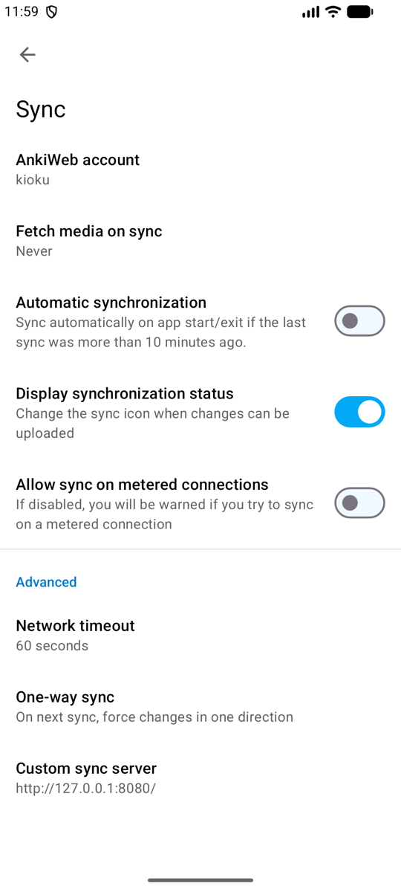
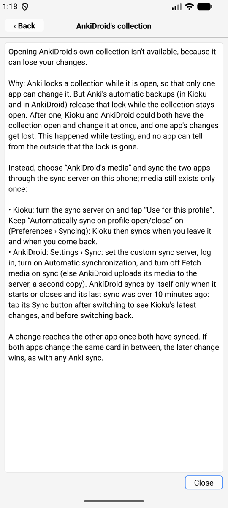

# AnkiDroid's media (Android)

> **Applies to:** Android native

For **large media collections** on a phone with AnkiDroid: a Kioku profile can
use AnkiDroid's `collection.media` folder instead of its own, so the media is
stored only once. The cards still come from the profile's own collection,
which syncs with AnkiDroid through the sync server above. Both apps can stay
open.

This works only with AnkiDroid builds that keep their folder in shared storage,
such as the GitHub "full" build (usually `/storage/emulated/0/AnkiDroid`). The
Play Store build keeps its folder where no other app can read it: use the sync
server alone instead.

Setting it up:

1. Turn on the sync server and press **Use for this profile**.
2. In AnkiDroid: Settings › Sync › Custom sync server (the address shown in
   Kioku), log in, and set **Fetch media on sync** to **Never**.
3. Sync AnkiDroid first (Upload if it asks), then the Kioku profile.
4. In Kioku: Preferences › Advanced › AnkiDroid's folder › **AnkiDroid's
   media**. Allow **All files access** when asked. Close Preferences: the
   profile opens again with AnkiDroid's media.

| AnkiDroid: Settings › Sync | Kioku: Preferences › Advanced |
| --- | --- |
|  |  |

The checks under the choices show what is missing, if anything: All files
access (with a button that opens Android's setting), the AnkiDroid version, the
folder's contents, and whether the profile syncs with the phone's server.

What changes for that profile:

- Media sync is turned off (Preferences › Syncing).
- Media you add in Kioku goes straight into AnkiDroid's folder.
- **Check Media won't delete unused files** unless you allow it: a file may
  belong to a card AnkiDroid hasn't synced yet. Sync both apps first.
- Restoring a whole collection (`.colpkg`) is turned off for the profile.
- The profile's own media folder is left as it was, and comes back if you
  switch back to "Kioku's own collection".

If AnkiDroid's folder can't be opened (no permission, folder moved), the
profile opens with its own collection and Kioku says why.

## Syncing when you switch between Kioku and AnkiDroid

Anki syncs automatically when a profile opens and closes, but phone apps are
rarely closed. So a Kioku profile that syncs with the phone's server also
syncs when you switch apps, as long as **Automatically sync on profile
open/close** is on (Preferences › Syncing; the checks in the Advanced tab
warn when it is off):

- **Leaving Kioku** with changes: Kioku sends them to the server before
  Android shows the next app (a local sync takes about 60 ms; the first one
  after Kioku starts can take over a second, and then finishes in the
  background). Only a normal sync runs then, without media and without
  questions.
- **Coming back** after more than 2 seconds: Kioku runs Anki's own sync,
  which brings in AnkiDroid's changes.
- A sync that needs a **full upload or download** is never done in the
  background: Kioku asks when you are back, as Anki always does. A sync
  error is shown when you are back too.

AnkiDroid's own automatic sync (Settings › Sync › **Automatic
synchronization**) runs only when it starts or closes, and only if its last
sync was **more than 10 minutes ago**. For a quick switch, tap AnkiDroid's
**Sync** button after opening it (to get Kioku's changes) and before going
back to Kioku (to send yours).

If both apps change the same card between two syncs, the later change wins,
as with any Anki sync; review history from both is kept.

## Why not open AnkiDroid's collection directly?

The Advanced tab lists **AnkiDroid's collection (not available)**. Tapping it
explains why instead of turning it on:

Anki locks a collection while it is open, so that only one app can change it.
But Anki's automatic backups, in Kioku and in AnkiDroid, release that lock
while the collection stays open: the backup reads the file through a second
file handle, and closing that handle drops the app's lock on the file. After a
backup, both apps could have the collection open at once. That happened while
testing, and AnkiDroid's answers were lost. Neither app can tell from the
outside that the lock is gone, so Kioku doesn't offer it until Anki (in both
apps) keeps its lock. Details: [testing.md](https://github.com/krmanik/kioku/blob/main/docs/testing.md#ankidroids-collection-2026-10-23).

"AnkiDroid's media" with the sync server above gets the same result safely:
media exists once on the phone, and each app has its own small copy of the
cards.
