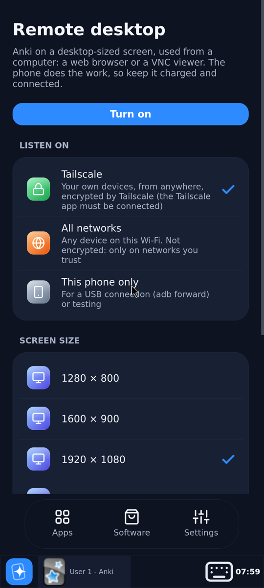
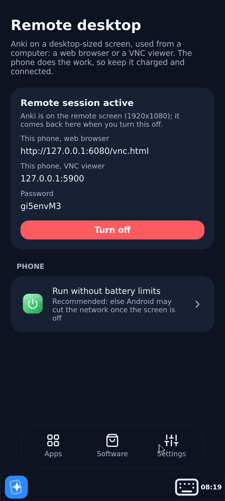
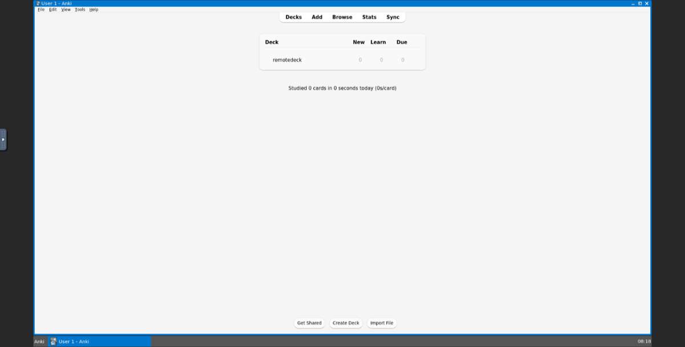

# Remote desktop

> **Applies to:** Android Termux

Use Kioku's Anki from a computer: in a web browser, or in any VNC viewer, on a
desktop-sized screen with a real mouse and keyboard. The phone does the work and
keeps your collection; the computer only shows it.

| The Remote page | While it is on | In a web browser |
|---|---|---|
|  |  |  |

**Settings › Remote desktop › Turn on.** Anki closes on the phone (it saves first,
as when it quits) and opens on the remote screen. The page then shows the
addresses to open on the computer and the password. The phone shows
**Remote session active** until you turn it off; Anki then moves back to the phone.

## Connecting

| From | Open |
|---|---|
| a web browser | `http://<address>:6080/` (the page shows the full address), then enter the password |
| a VNC viewer (TigerVNC, RealVNC, macOS Screen Sharing, Remmina) | `<address>:5900`, then the password |

Where Kioku listens (choose it before turning it on):

| Listen on | Who can connect |
|---|---|
| **Tailscale** (default) | your own devices on your Tailscale network, from anywhere. Tailscale encrypts the connection. The Tailscale app must be connected on the phone. |
| **All networks** | any device on the same Wi-Fi or VPN. **Not encrypted**: VNC only scrambles the password check. Use it only on networks you trust. |
| **This phone only** | nothing outside the phone; for a USB cable with `adb forward tcp:6080 tcp:6080 && adb forward tcp:5900 tcp:5900`, then `http://localhost:6080/vnc.html` on the computer. |

The password is made up when you first open the page; tap it for a new one. VNC
uses at most 8 characters of a password, so it is 8 random letters and digits.

Screen sizes: 1280 × 800, 1600 × 900, 1920 × 1080 (default) and 2560 × 1440, or
**Custom**: any width × height from 640 × 480 to 7680 × 4320, such as a tablet's
2388 × 1668. The web viewer scales the screen to the browser window.

With the XFCE desktop, **Settings › Display** can change the resolution, up to the
size chosen here; the viewer follows. **Scale** there doesn't work on the remote
screen (it has no hardware to scale with): the screen comes back as it was after a
few seconds. For bigger text and buttons use **Settings › Appearance › Settings ›
Window Scaling**, or choose a smaller screen size here.

## While it is on

- Anki runs on the remote screen at 100% size, without the phone's touch changes
  (on-screen keyboard, one-finger scrolling). For bigger text and buttons, change
  Anki's **Preferences › Appearance › User interface size** there (up to 300%) and
  restart Anki from the taskbar: the remote screen keeps its own size, separate
  from the phone's. Its windows have a taskbar, with an
  **Anki** button to open it again if you close it.
- Tapping Anki on the phone shows the Remote page instead: Anki can be open in one
  place only.
- Other apps on the phone's desktop keep working on the phone.
- The phone keeps the CPU and Wi-Fi awake (a wake lock and a Wi-Fi lock), and the
  notification says that the remote desktop is on. This uses battery: keep the
  phone charging for long sessions.
- **Run without battery limits** (on the Remote page): Android otherwise stops the
  network of an app with the screen off after a while (Doze), which ends the
  session. Android asks once; the page shows whether it is allowed.

## Turning it off

**Turn off** on the Remote page. Anki on the remote screen closes (it saves first)
and opens on the phone again. If Anki doesn't close because one of its windows is
asking something (an unsaved card in Add, say), the session stays on so you can
answer it on the computer; then turn it off again.

**Power off** in Settings also ends the remote session first.

If Kioku is stopped some other way (Android ends it, or the phone restarts), the
remote session is gone too, and Anki opens on the phone the next time.

