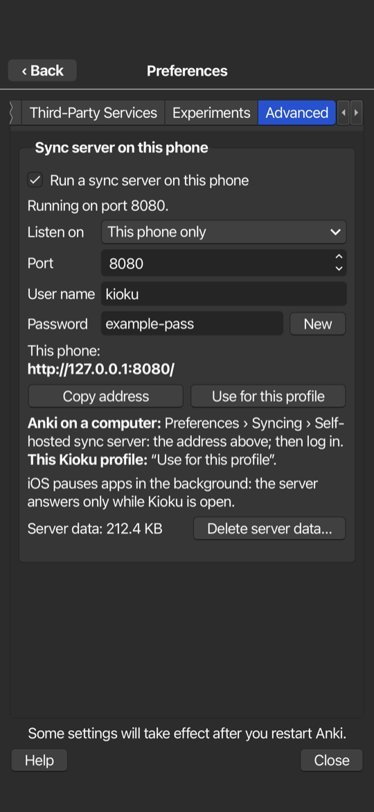
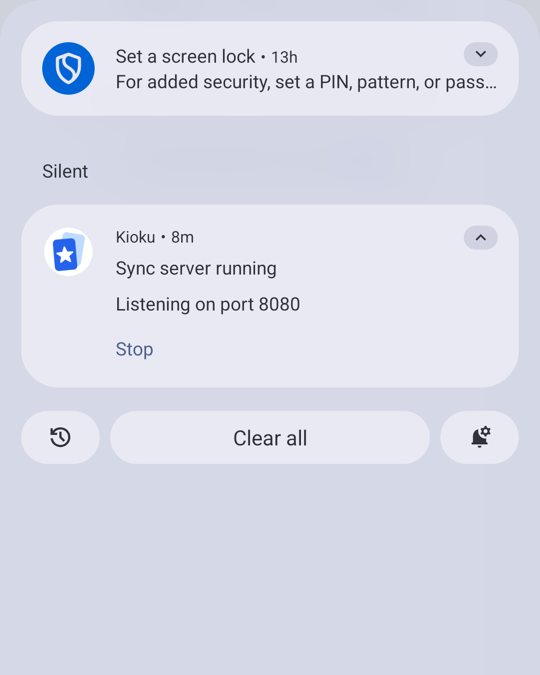

# Sync server on the phone

> **Applies to:** iPhone/iPad, Android native, Android Termux

Kioku adds an **Advanced** tab to Anki's Preferences, with options for
experienced users. Everything there is off until
you turn it on, and each option explains its risks first.

## Sync server on this phone

Kioku can run Anki's own sync server (the one behind `anki --syncserver`) on
the phone. Then the phone can be the sync server, with no AnkiWeb needed:

- **AnkiDroid on the same phone** syncs with Kioku: Settings › Sync ›
  Custom sync server › Sync URL `http://127.0.0.1:8080/`, then log in with the
  user name and password shown in Kioku.
- **Kioku's own profiles** sync with it: press **Use for this profile**.
- **Anki on your computers** syncs with it over Tailscale (or your Wi-Fi):
  Preferences › Syncing › Self-hosted sync server.

| Android | iPhone | Android's notification |
| --- | --- | --- |
|  |  |  |

| Setting | Meaning |
| --- | --- |
| Listen on: This phone only | only apps on the phone can connect (default) |
| Listen on: Tailscale | the phone's Tailscale address; your Tailscale devices can connect, encrypted by Tailscale |
| Listen on: All networks | any device on the same Wi-Fi or VPN can connect. Plain HTTP: only on networks you trust |
| Port | 8080 by default; choose another if an app already uses it |
| User name, password | a password is made up when you first turn the server on. **New** makes another one; devices then log in again |
| Delete server data | removes everything synced to the phone's server; each device's next sync is a full upload |

Things to know:

- The server keeps **its own copy** of everything synced to it (collection and
  media) in Kioku's private storage. It needs that much free space.
- A device that syncs with the phone **no longer syncs with AnkiWeb**.
- The first time, choose **Upload** on the device that has your cards and
  **Download** on the others.
- Two devices syncing at the same moment: one of them gets Anki's "Only one
  copy of Anki can sync to your account at once" error. Nothing is lost; sync
  it again a moment later.
- **Android:** while the server runs, a notification shows and Kioku keeps
  running in the background (its **Stop** action stops the server until
  Kioku starts again). Allow notifications when Android asks, or the
  notification stays hidden.
- **iPhone:** iOS pauses apps in the background, so the server only answers
  while Kioku is open. It starts again by itself when you come back.

