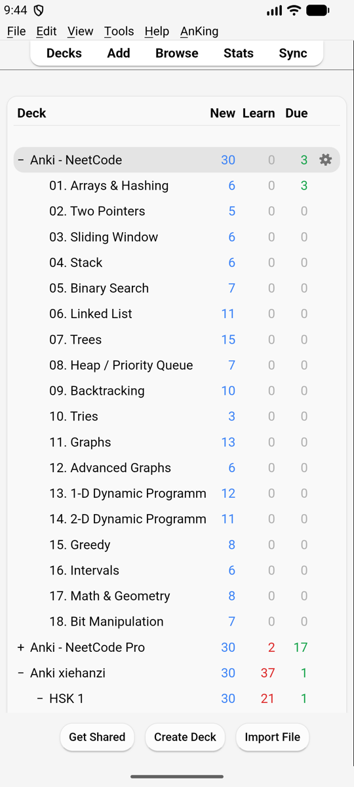
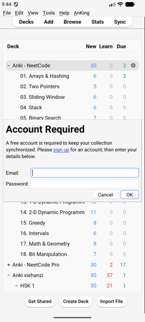

# Getting Started

> **Applies to:** iPhone/iPad, Android native, Android Termux, web, Docker

## First start

Like Anki on a computer, Kioku asks for the **language** the first time, then
opens the deck list with an empty profile (**User 1**).

From here it's Anki: see [Getting Started](https://docs.ankiweb.net/getting-started.html)
in Anki's manual.

## Bringing your cards

Pick one:

- **AnkiWeb.** Tap **Sync** in the top bar and log in with your AnkiWeb
  account. In an empty profile choose **Download** to get your collection.
  Login and media sync work as on a computer
  ([Anki: Syncing](https://docs.ankiweb.net/syncing.html)). The login stays
  after restarting Kioku.
- **A collection file.** Export a `.colpkg` (or `.apkg`) from Anki on your
  computer, put it on the phone, and import it: see
  [Your Files](using/files.md#importing).
- **AnkiDroid on the same Android phone.** Sync both apps through
  [the phone's sync server](features/sync-server.md), no AnkiWeb needed.
- **Your server (Docker).** Copy your whole Anki folder there: see
  [Your existing collection](install/self-hosted.md#your-existing-collection).

Several people or setups? Use **profiles** (File › Switch Profile), as in
[Anki](https://docs.ankiweb.net/profiles.html).

## Next

- [Using Kioku on a phone](using/intro.md): how windows, Back and the
  keyboard work.
- [Add-ons](using/addons.md): installing desktop add-ons on the phone.
