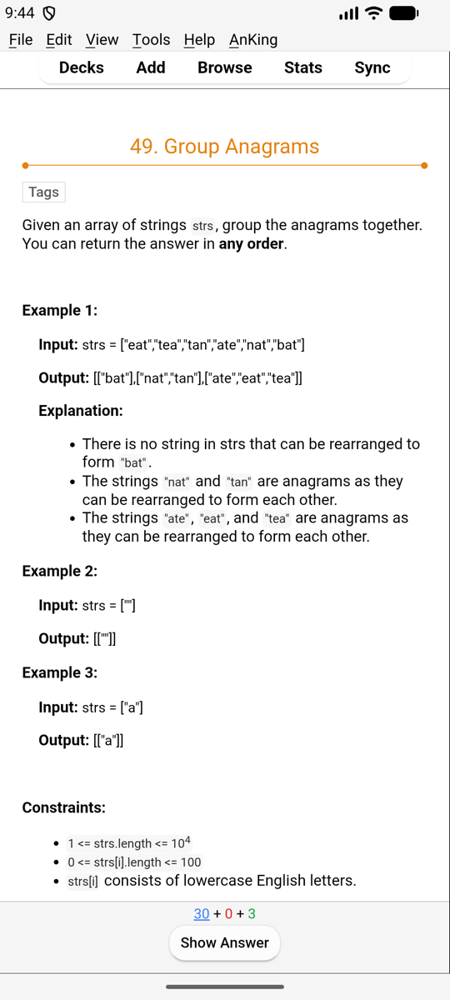
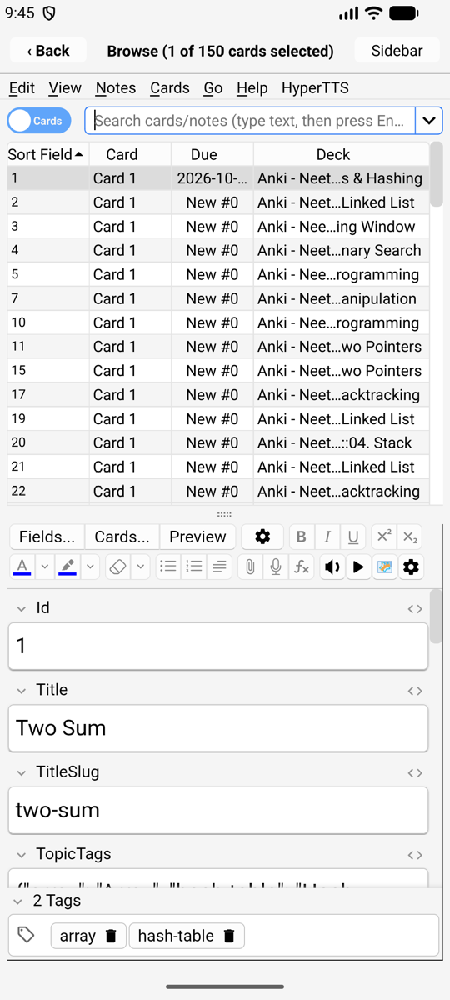
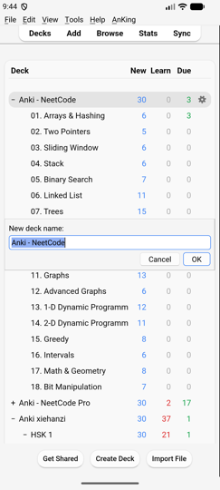
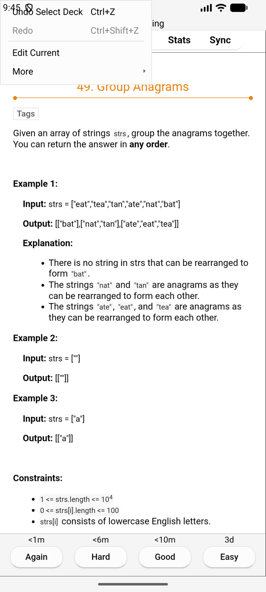
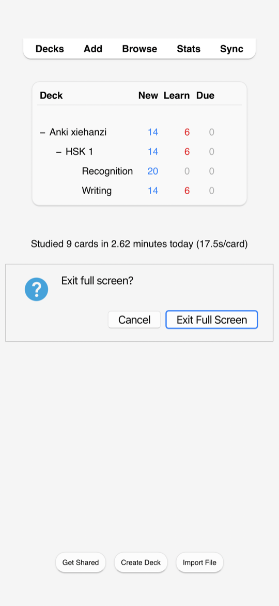

# Native apps (iPhone, Android)

> **Applies to:** iPhone/iPad, Android native

| Deck list | Reviewing | Browse |
| :---: | :---: | :---: |
|  |  |  |

## Windows

- **The main window** (deck list, overview, reviewer) fills the screen, with
  Anki's menu bar at the top: **File, Edit, View, Tools, Help** and add-on
  menus.
- **Every other window** (Browse, Add, Statistics, Preferences, Deck Options…)
  opens full screen on top, with a title bar.
- **Closing a window:**
  - iPhone, iPad: **‹ Back** in its title bar.
  - Android: the **Back** key or gesture closes the top window. On the main
    window it moves Kioku to the background (Anki keeps running).
- **Small windows** (the AnkiWeb login, Create Deck, Rename, message boxes)
  are cards in the middle of the screen, sized to their content, and move up
  above the keyboard while you type.

| A prompt | A login | The Edit menu while reviewing |
| :---: | :---: | :---: |
|  |  |  |

## Touch

- **Tap** for a click, **drag** to scroll lists and pages.
- **While reviewing**, Anki hides its Edit and More buttons on a narrow
  screen; Kioku offers them in the **Edit** menu (**Edit Current**,
  **More**: flag, bury, suspend, card info…).
- **Landscape** works; windows follow the rotation.
- Keyboard shortcuts work with a hardware keyboard (Space to show the answer,
  1–4 to answer, as in [Anki](https://docs.ankiweb.net/studying.html#keyboard-shortcuts)).

## Full screen

**View › Full Screen** hides the menu bar (and the status bar) for more room.
To leave it, **swipe right** on the screen and tap **Exit Full Screen**
(or **Cancel** to stay in full screen).
Kioku reminds you of this for a few seconds when you enter full screen.
On a page that scrolls sideways, scroll it back to its left edge first.

## Keyboard

The on-screen keyboard opens when you tap a text field and closes when you
tap elsewhere. On Android the keyboard's Enter key (✓) submits single-line
fields: Browse's search, prompts, the login.

## Sound and speech

- **Card audio** (mp3, wav, Ogg Vorbis, Opus) plays as in Anki, with the
  replay buttons.
- **`{{tts}}` text-to-speech** uses the phone's voices: iOS's voices, and
  Android's text-to-speech engine (Settings › Text-to-speech on the phone).
  Install a voice for the language you need there.

## In the background

- **Android:** Kioku keeps running in the background like other apps; Android
  may stop it when memory runs low. Your collection is saved whenever Kioku
  leaves the screen.
- **iPhone, iPad:** iOS pauses Kioku in the background. It saves first.

## Web views

Cards, the editor and statistics are web pages in the system's web view. Card
JavaScript works. For card template authors: the web views can be inspected
with Safari's Web Inspector (iOS) or `chrome://inspect` (Android).

## Differences from Anki on a computer

- File dialogs are the phone's own file picker ([Your Files](files.md)).
- "Show in folder" / "Open folder" show the folder's path instead of a file
  manager on Android.
- Add-ons that start other programs don't work ([Add-ons](addons.md)).
- The card types editor (Cards…) is cramped in portrait; turn the phone.
