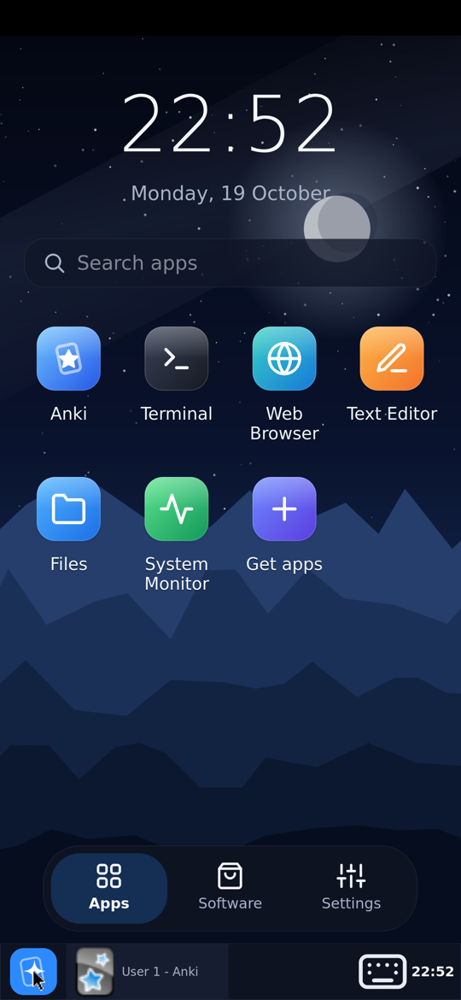

# Termux desktop

> **Applies to:** Android Termux

The Termux variant starts a tiny Linux desktop with Anki open. Anki runs
exactly as on a Linux PC; closing Anki returns to the desktop, where the
Anki icon opens it again.

| Desktop | Software | Settings |
| :---: | :---: | :---: |
|  |  |  |

## The desktop

- **Apps**: a clock, search, Anki, Terminal and every app you installed.
- **Software**: recommended Linux apps (Files, Text Editor, QTerminal, Web
  Browser, Image Viewer, Archives, System Monitor) and a search over every
  package in the Termux repositories. Install or remove with one tap.
- **Settings**: wallpaper (six built in, or your own picture), touch screen
  or mouse pad, keyboard, import a deck, phone storage, display settings,
  [remote desktop](../features/remote-desktop.md), restart desktop,
  **Power off**.

## The dock

| To… | Do this |
| --- | --- |
| see the desktop | tap the **Kioku** button at the start of the dock; tap again to get the windows back |
| switch windows | tap a window in the dock |
| show or hide the keyboard | the keyboard button in the dock |

In landscape the dock moves to the right edge.

## Touch screen or mouse pad

Settings › **Touch screen**: tap to click, drag to scroll (with momentum).
Settings › **Mouse pad**: one finger moves a pointer, tap to click, two
fingers scroll; like a laptop's touchpad.

Other apps (web browser, file manager) get real touch events: drag to
scroll, long press to select text.

## Keyboard

Text fields open the Android keyboard; tapping elsewhere closes it. In other
apps, the keyboard opens when you tap where text can be typed (a terminal, a
text box). The dock's keyboard button always works.

## Closing Kioku

**Settings › Power off** closes Anki (it saves the collection) and ends the
session.

## If start-up fails

The splash screen shows what went wrong, with:

- **Retry**,
- **Safe mode**: Anki without add-ons (for a broken add-on),
- **Repair runtime**: unpacks the runtime again; your decks are kept,
- **Share log**: send the log with a bug report.
