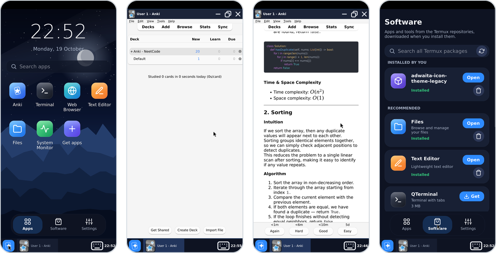

# Which variant?

Kioku comes in three variants. All run the same Anki release (26.08.1) and
can sync with each other through AnkiWeb or [the phone's sync
server](features/sync-server.md).

| | iPhone, iPad | Android, native | Android, Termux |
| --- | --- | --- | --- |
| **Needs** | iOS 17+ | Android 9+, arm64 | Android 7+, arm64, ~1 GB free, 3 GB+ RAM |
| **Download size** | 39 MB | 48 MB | 235 MB |
| **Looks like** | a phone app: every window full screen | a phone app: every window full screen | a small Linux desktop with a dock |
| **Web pages** (cards, editor, stats) | the system web view | Android System WebView | Qt WebEngine, as on a PC |
| **Add-ons** | yes, except ones that start programs | yes, except ones that start programs | yes, as on Linux |
| **Other Linux apps** | no | no | yes, on demand |
| **Sync server, AnkiDroid's media** | sync server | both | no |
| **Remote desktop** | no | no | yes |
| **Pick it if** | you have an iPhone or iPad | you want a light, fast app | you want the full desktop and every add-on |

Both Android variants can be installed side by side; they keep separate
collections.

## iPhone and iPad

## Android, native

## Android, Termux

