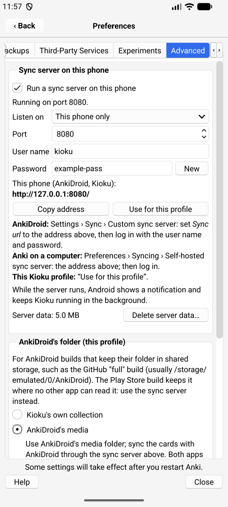
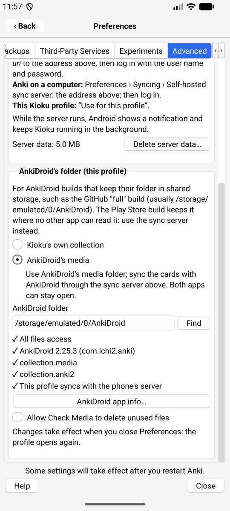

# Sync server and AnkiDroid's media (Preferences › Advanced)

The native iPhone and Android apps have an **Advanced** tab in Anki's
Preferences, with options for experienced users. Everything there is off until
you turn it on, and each option explains its risks first.

## Sync server on this phone

Kioku can run Anki's own sync server (the one behind `anki --syncserver`) on
the phone. Then the phone can be the sync server, with no AnkiWeb needed:

- **AnkiDroid on the same phone** syncs with Kioku: Settings › Sync ›
  Custom sync server › Sync URL `http://127.0.0.1:8080/`, then log in with the
  user name and password shown in Kioku.
- **Kioku's own profiles** sync with it: press **Use for this profile**.
- **Anki on your computers** syncs with it over Tailscale (or your Wi-Fi):
  Preferences › Syncing › Self-hosted sync server.

| Android | iPhone | Android's notification |
| --- | --- | --- |
|  |  |  |

| Setting | Meaning |
| --- | --- |
| Listen on: This phone only | only apps on the phone can connect (default) |
| Listen on: Tailscale | the phone's Tailscale address; your Tailscale devices can connect, encrypted by Tailscale |
| Listen on: All networks | any device on the same Wi-Fi or VPN can connect. Plain HTTP: only on networks you trust |
| Port | 8080 by default; choose another if an app already uses it |
| User name, password | a password is made up when you first turn the server on. **New** makes another one; devices then log in again |
| Delete server data | removes everything synced to the phone's server; each device's next sync is a full upload |

Things to know:

- The server keeps **its own copy** of everything synced to it (collection and
  media) in Kioku's private storage. It needs that much free space.
- A device that syncs with the phone **no longer syncs with AnkiWeb**.
- The first time, choose **Upload** on the device that has your cards and
  **Download** on the others.
- Two devices syncing at the same moment: one of them gets Anki's "Only one
  copy of Anki can sync to your account at once" error. Nothing is lost; sync
  it again a moment later.
- **Android:** while the server runs, a notification shows and Kioku keeps
  running in the background (its **Stop** action stops the server until
  Kioku starts again). Allow notifications when Android asks, or the
  notification stays hidden.
- **iPhone:** iOS pauses apps in the background, so the server only answers
  while Kioku is open. It starts again by itself when you come back.

## AnkiDroid's media (Android)

For **large media collections** on a phone with AnkiDroid: a Kioku profile can
use AnkiDroid's `collection.media` folder instead of its own, so the media is
stored only once. The cards still come from the profile's own collection,
which syncs with AnkiDroid through the sync server above. Both apps can stay
open.

This works only with AnkiDroid builds that keep their folder in shared storage,
such as the GitHub "full" build (usually `/storage/emulated/0/AnkiDroid`). The
Play Store build keeps its folder where no other app can read it: use the sync
server alone instead.

Setting it up:

1. Turn on the sync server and press **Use for this profile**.
2. In AnkiDroid: Settings › Sync › Custom sync server (the address shown in
   Kioku), log in, and set **Fetch media on sync** to **Never**.
3. Sync AnkiDroid first (Upload if it asks), then the Kioku profile.
4. In Kioku: Preferences › Advanced › AnkiDroid's folder › **AnkiDroid's
   media**. Allow **All files access** when asked. Close Preferences: the
   profile opens again with AnkiDroid's media.

| AnkiDroid: Settings › Sync | Kioku: Preferences › Advanced |
| --- | --- |
|  |  |

The checks under the choices show what is missing, if anything: All files
access (with a button that opens Android's setting), the AnkiDroid version, the
folder's contents, and whether the profile syncs with the phone's server.

What changes for that profile:

- Media sync is turned off (Preferences › Syncing).
- Media you add in Kioku goes straight into AnkiDroid's folder.
- **Check Media won't delete unused files** unless you allow it: a file may
  belong to a card AnkiDroid hasn't synced yet. Sync both apps first.
- Restoring a whole collection (`.colpkg`) is turned off for the profile.
- The profile's own media folder is left as it was, and comes back if you
  switch back to "Kioku's own collection".

If AnkiDroid's folder can't be opened (no permission, folder moved), the
profile opens with its own collection and Kioku says why.
