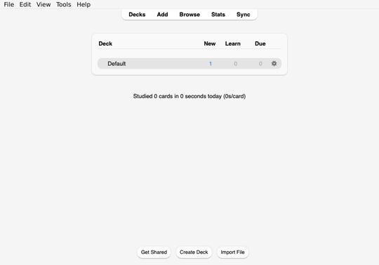
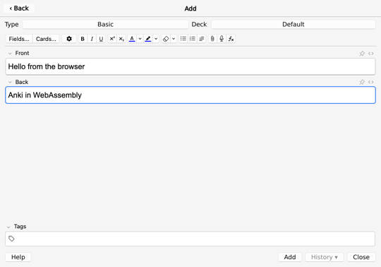
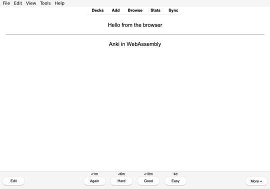
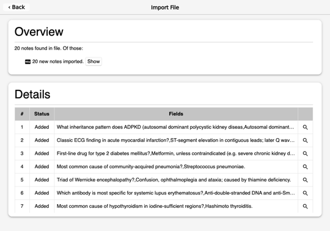

# Kioku for the web

Unmodified Anki desktop (aqt 26.09.3) running in a browser tab: CPython
3.14, PyQt6, Qt 6.11 and Anki's Rust core compiled to WebAssembly and
linked into one static `kioku.wasm`, the same design as
[Kioku](https://github.com/krmanik/kioku)'s iOS and Android apps. This is an
early port, not something to ship: studying works, but nothing survives a
reload yet.

> [!WARNING]
> Experimental and unstable, for testing only: it may crash or lose data.
> Back up your collection **with scheduling information** first (a
> `.colpkg`, or an `.apkg` with "Include scheduling information"), and sync
> with a **test AnkiWeb account**, not the one you use. The app page says
> the same when it opens.

 
 

## Status (2026-10-24, headless Chrome)

Works: first-run dialogs, profile creation, the main window; the deck list,
deck overview, reviewer (with Anki's keyboard shortcuts), Add (the editor),
Import (.apkg through the browser's file picker), Browse, Stats, Check
Database, export (as a browser download), card audio and `{{tts}}` (Web
Speech API). Profiles, collections and media are kept in the browser's
IndexedDB across reloads. Dialogs that block (`QDialog.exec()`) and
collection work on background threads behave like on the desktop.

Sync with AnkiWeb or a self-hosted server works through a WebSocket→TCP
relay in `tools/serve.py`; so do add-ons (Get Add-ons, Python HTTPS
through OpenSSL built for wasm). The app can be served from any origin;
[`cloudflare/`](cloudflare/) hosts it on Cloudflare Workers' free plan
(running at <https://kioku.krmanik.workers.dev>).

Download: `kioku.wasm` 100 MB (17 MB with brotli), `kioku.data` 48 MB
with fonts and time zones (14 MB with brotli).

## Limits

- **Size.** Profiles, collections and media live in the tab's memory and
  are saved to IndexedDB. 3 GB of files saved and came back in desktop
  Chrome (docs/testing.md); the tab then uses about as much RAM, and
  phones have far less. The browser's quota is a share of the free disk
  (Chrome: up to 60%).
- **Keeping data.** The app asks for persistent storage after the notice;
  without it the browser may delete the data when the disk runs low, and
  Safari deletes it after 7 days without a visit. Export backups.
- **Saving** copies each changed file whole (the collection after every
  review), on the main thread: fine for small collections, slow for
  large ones.

## Quick start

Runs from `web/` and uses the rest of the Kioku repository (`..`, or set
`KIOKU_REPO`), with its iOS dependencies fetched and built
(`ios/tools/fetch_deps.sh`, `ios/tools/build.sh` or at least its site-packages
and PyQt6 sdists), plus nightly Rust with `rust-src`, `protoc`, `uvx`,
Python 3.14, Ninja and Chrome.

```sh
cd web
tools/fetch_deps.sh      # Emscripten 4.0.7, Qt 6.11 for WebAssembly, fonts
tools/build_python.sh    # CPython 3.14 for Emscripten (patched; builds OpenSSL first)
tools/build_rust.sh      # Anki's Rust core for wasm32-unknown-emscripten
tools/build_rpds.sh      # rpds-py (jsonschema, add-on manifests)
tools/build_orjson.sh    # orjson (faster JSON for Anki's core)
tools/gen_pyqt.sh        # PyQt6 bindings for Qt for WebAssembly
tools/prepare_site.sh    # Anki's Python packages
tools/build.sh           # build/cmake: kioku.wasm, app.html, sw.js, ...
python3 tools/serve.py build/cmake 8765
```

Open <http://127.0.0.1:8765/> (or `localhost`). Other machines
can't use plain `http://` with a LAN address: service workers and threads
need a secure context (`https://`, `localhost` or `127.0.0.1`).
The app's Python and `shell/` are packed into `app.data` and copied by
`tools/pack_app.sh` on every `tools/build.sh` without relinking (seconds);
changes to C++, Rust, the stdlib or site-packages relink (about 5 minutes,
Asyncify is slow).

## Hosting on Cloudflare (free)

GitHub Pages can't send the COOP/COEP headers threads need, nor run the
socket relay sync uses. A Cloudflare Worker does both (details in
[docs/architecture.md](docs/architecture.md#hosting-cloudflare-toolsdistsh)):

```sh
tools/build.sh                 # as above
tools/dist.sh                  # build/dist: page files, wasm and data brotli-compressed (25 MiB limit)
cd cloudflare && npm install
npx wrangler dev               # try it at http://127.0.0.1:8787/
npx wrangler login             # once, with a free Cloudflare account
npx wrangler deploy            # https://kioku.<your subdomain>.workers.dev/
```

Run `tools/dist.sh` again after each build. The relay reaches only the
hosts in `RELAY_ALLOW` (`cloudflare/wrangler.jsonc`, AnkiWeb by default):
on a public URL anyone can use it, so keep the list short and add only the
services your add-ons need (`"ankiweb.net:443,*.ankiweb.net:443,*.amboss.com:443"`).
Data stays in each visitor's browser (IndexedDB); nothing is stored on
Cloudflare.

## Layout

| Path | What |
| --- | --- |
| `src/main.cpp` | CPython embedding, statically linked extension modules, the `_kioku_web` module and the `kioku_post` export |
| `python/kioku_platform/` | the web platform layer for Kioku's shared `kioku` package: web views, in-process web server, files |
| `shell/` | the app page, its service worker and JavaScript glue |
| `cloudflare/` | hosting on Cloudflare Workers: `worker.js` (isolation headers, compressed wasm, socket relay), `wrangler.jsonc` |
| `patches/` | patches for Rust crates, CPython and PyQt6 |
| `tools/` | build scripts, `serve.py`, `dist.sh` (files for hosting), the node core test (`link_core.sh`, `core/`), the browser driver (`test/`) |
| `app/probe.py` | the first feasibility probe (Qt's `kioku.html` runs it) |
| `docs/` | [architecture](docs/architecture.md), [fixes](docs/fixes.md), [testing](docs/testing.md) |
